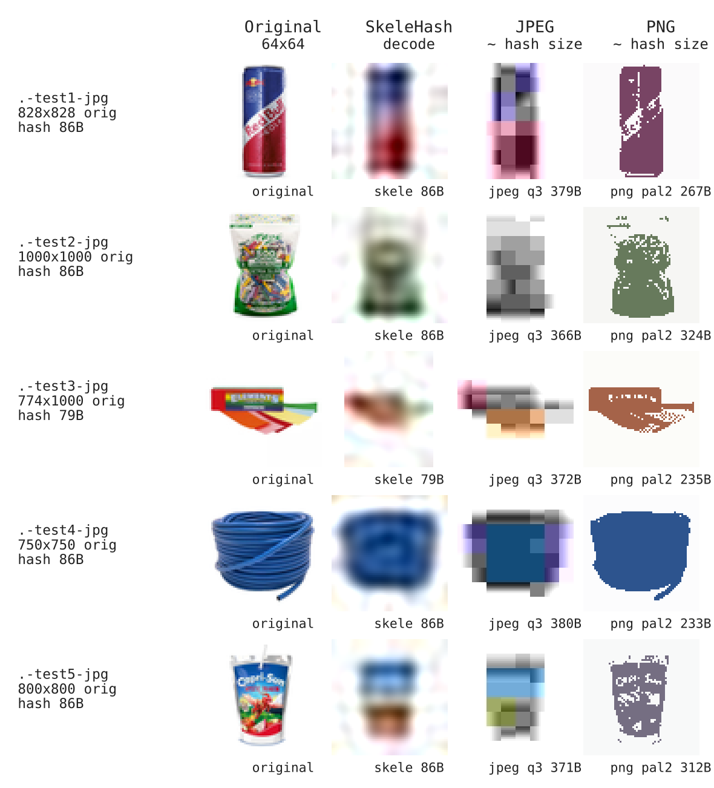

# skelehash-wasm

> **SkeleHash**: tiny DCT image placeholder codec compiled to WebAssembly for Node.js and browsers.

Encode any image (downscaled up to 200px max edge) into a compact **~86-byte Base62 hash**, and decode it into a blurry 64px-max-edge RGBA placeholder for blur-up loading. Alpha transparency is fully supported.

---

## Why SkeleHash?

Placeholder hashes (like ThumbHash and BlurHash) allow you to display smooth, visually representative image placeholders while full-resolution images load over the network.

---

## Visual Comparison



---

## Installation

```bash
npm install skelehash-wasm
```

---

## Usage in Node.js

In Node.js, `encodeRGBA` and `decodeBase62` automatically run in a worker thread.

### 1. Encoding an Image to SkeleHash (with Sharp)

```javascript
import { encodeRGBA } from 'skelehash-wasm';
import sharp from 'sharp';

// 1. Resize image to fit within 200x200 and extract raw RGBA pixels
const { data, info } = await sharp('input.jpg')
  .rotate()
  .resize({ width: 200, height: 200, fit: 'inside' })
  .ensureAlpha()
  .raw()
  .toBuffer({ resolveWithObject: true });

// 2. Encode to SkeleHash
const result = await encodeRGBA(info.width, info.height, data);

console.log('Base62 Hash:', result.base62);
// e.g. "FB6sUvZhx7Ujsnlnn2i7f2eJLamnegkYVlHgPdIsjZo51sKozzVe7s4EEgdJJAvXrQylui4g78OoGw"
console.log('Hash byte size:', result.hash.length); // ~86 bytes
```

### 2. Decoding a SkeleHash to RGBA Placeholders

```javascript
import { decodeBase62 } from 'skelehash-wasm';
import sharp from 'sharp';

const hashString = 'FB6sUvZhx7Ujsnlnn2i7f2eJLamnegkYVlHgPdIsjZo51sKozzVe7s4EEgdJJAvXrQylui4g78OoGw';

const decoded = await decodeBase62(hashString);

console.log(`Decoded dimensions: ${decoded.metadata.outputWidth}x${decoded.metadata.outputHeight}`);
// decoded.rgba contains raw RGBA Uint8Array (outputWidth * outputHeight * 4 bytes)

// Optional: save to PNG using sharp
await sharp(Buffer.from(decoded.rgba), {
  raw: {
    width: decoded.metadata.outputWidth,
    height: decoded.metadata.outputHeight,
    channels: 4,
  },
})
  .png()
  .toFile('placeholder.png');
```

---

## Usage in Browsers / Vite

In browsers or modern bundlers (Vite, Webpack, Next.js), import directly:

```javascript
import { encodeRGBA, decodeBase62 } from 'skelehash-wasm';

// Decoding to an HTML Canvas placeholder
async function renderPlaceholder(canvas, base62String) {
  const { rgba, metadata } = await decodeBase62(base62String);

  canvas.width = metadata.outputWidth;
  canvas.height = metadata.outputHeight;

  const ctx = canvas.getContext('2d');
  const clamped = new Uint8ClampedArray(rgba.buffer, rgba.byteOffset, rgba.byteLength);
  const imageData = new ImageData(clamped, metadata.outputWidth, metadata.outputHeight);

  ctx.putImageData(imageData, 0, 0);
}
```

---

## API Reference

### `encodeRGBA(width, height, rgba)`

Encodes unpremultiplied RGBA bytes into a SkeleHash.

* **`width`** (`number`): Image width, integer `1..200`.
* **`height`** (`number`): Image height, integer `1..200`.
* **`rgba`** (`Uint8Array | Uint8ClampedArray | ArrayBuffer | Buffer`): Exactly `width * height * 4` RGBA bytes.
* **Returns**: `Promise<{ status: number, base62: string, hash: Uint8Array, rgba: null, metadata: object }>`

### `decodeBase62(base62)`

Decodes a canonical Base62 string into unpremultiplied RGBA placeholder bytes.

* **`base62`** (`string`): Canonical Base62 text (`1..320` ASCII characters).
* **Returns**: `Promise<{ status: number, base62: string, hash: Uint8Array, rgba: Uint8Array, metadata: object }>`
  * `rgba`: Uint8Array of size `metadata.outputWidth * metadata.outputHeight * 4`.
  * `metadata`: Object containing `version`, `sourceWidth`, `sourceHeight`, `outputWidth`, `outputHeight`, `hasAlpha`, `aspectRatio`, etc.

### `encodeDecode(width, height, rgba)`

Helper function performing a round-trip encode followed by decode.

* **Returns**: `Promise<{ encoded, decoded }>`

### Node.js Direct Exports (`*Sync`)

For execution inside existing worker threads or where dispatching to a dedicated thread is unnecessary, Node.js entrypoints export direct execution versions:

* `encodeRGBASync(width, height, rgba)`
* `decodeBase62Sync(base62)`
* `encodeDecodeSync(width, height, rgba)`

*(Note: These functions execute synchronously on the current thread and return Promises that resolve upon completion).*

---

### Rebuilding WebAssembly Binaries

Requires Docker:

```bash
npm run build
```

This compiles `src/skelehash.c` with Emscripten inside Docker and copies `skelehash.js` and `skelehash.wasm` to the root directory.
